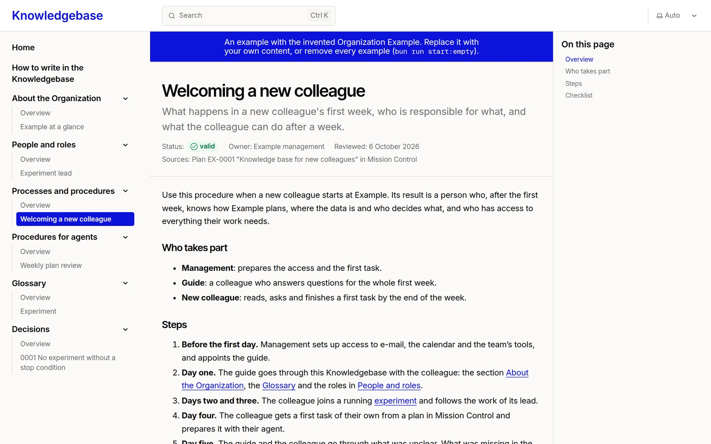

# Knowledgebase

The knowledge base of an Organization: its procedures, knowledge, glossary
and decisions, written down once for people and for agents. People read it
when they need to find out how something is done; agents search it before
they answer how the Organization works, and write into it what was confirmed.
The example content describes **Example**, an invented Organization. All
content is fictional.

The repository is a module that follows the
[Lazurio Module Standard](https://github.com/Lazurio/LazurioPlatform/blob/main/docs/module-standard.md).



## A template in the Marketplace of Lazurio

This repository is a public template: another Organization can adopt the
structure, the App, the skills for agents and the tests, and fill the
knowledge base with its own content. The Marketplace of Lazurio offers it
under "Přidat do Organizace"; an agent then follows
[`docs/adoption.md`](docs/adoption.md), creates a private module of that
Organization and merges a release of this repository into it, so that later
releases arrive as ordinary merges. Nothing is installed or published without
the person's instruction. LazurioTemplates publishes the template.

- App generation `app/v2`: no data layer of its own; the content lies beside
  the App in `data/v2/` with a structure the App checks.
- Stack profile [`content@2026.11`](https://github.com/Lazurio/LazurioPlatform/blob/main/docs/stack-profiles.md#content):
  Bun 1.4.4, Astro 7.4.5, Starlight 0.42.8, TypeScript 6.0.3, Biome 2.6.4,
  every version exact.
- Czech and English: the interface, the structure and the example in both
  languages. The knowledge base is written and shown in one of them, the
  language of Lazurio for the Organization, Czech by default
  (`bun run start:language <cs|en>`).
- Two starts: the invented example (one page in every section) or empty
  (`bun run start:empty` keeps only the structure).
- The look comes from the Organization's design system as a locked copy of
  its tokens ([`LazurioTemplates/design-system`](https://github.com/LazurioTemplates/design-system)
  v1.0.0 in this release, taken by `bun run design-system:sync`), never read
  at run time.
- [`docs/extending.md`](docs/extending.md): changes within the generation,
  when the knowledge base would change generation, taking a newer release,
  releasing.
- Releases are annotated tags `v<semver>` with a GitHub Release
  ([`CHANGELOG.md`](CHANGELOG.md)). Screens for the Marketplace card:
  [`docs/screenshots/`](docs/screenshots/).

## What is in it

| Section (`kind`) | Holds | Example page (English) |
|---|---|---|
| About the Organization, O Organizaci (`organization`) | What the Organization does, for whom, how it earns and by what it decides | Example at a glance |
| People and roles, Lidé a role (`roles`) | Who is responsible for what, who stands in, whom to ask | Experiment lead |
| Processes and procedures, Procesy a postupy (`processes`) | Repeated work step by step, for people | Welcoming a new colleague |
| Procedures for agents, Postupy pro agenty (`agent-procedures`) | Repeated work of an agent: what it may do alone and where it stops | Weekly plan review |
| Glossary, Slovník (`glossary`) | One page per term, with its other names and what not to confuse it with | Experiment |
| Decisions, Rozhodnutí (`decisions`) | Numbered decisions: who decided, when, why and what follows | 0001 No experiment without a stop condition |

Every section has an overview page with what belongs there and the outline of
a page; the overviews, the home page and the guide (How to write in the
Knowledgebase, Jak psát do Knowledgebase) stay in the empty start. The
interface and the content are Czech or English, never mixed on a screen; the
code and the documents of the repository are in English.

## For agents

The module carries its procedures for agents as skills in `.agents/skills/`
(Codex) with a byte-for-byte mirror in `.claude/skills/` (Claude Code):

- `knowledgebase-search`: search the knowledge base before answering how the
  Organization works, and name the page;
- `knowledgebase-write-procedure`: "zapiš postup";
- `knowledgebase-record-decision`: "zapiš rozhodnutí";
- `knowledgebase-add-term`: "doplň slovník".

[`AGENTS.md`](AGENTS.md) holds the rules; [`docs/adoption.md`](docs/adoption.md)
says how the Organization root points its agents here.

## Layout

| Path | Holds |
|---|---|
| `data/v2/knowledgebase.json` | The declared structure: the language shown and, for each language, its root pages, sections and their kinds |
| `data/v2/docs/cs/`, `data/v2/docs/en/` | The pages of each language, Markdown with frontmatter |
| `data/v2/public/` | Files the pages link to, and the favicon |
| `app/v2/` | The read-only viewer App (Astro and Starlight, TypeScript) and the tools `start:empty`, `start:language`, `design-system:sync`, `theme:write` |
| `app/v2/src/design-system/` | The copy of the design system's tokens, its lock and the theme made from it |
| `.agents/skills/`, `.claude/skills/` | The skills for agents |
| `docs/` | Adoption, extending, the Marketplace screens per language (`docs/screenshots/cs/`, `docs/screenshots/en/`) |
| `lazurio.module.json` | Module id, port lease and Apps |
| `LICENSE`, `NOTICE` | MIT license; what it covers and the third-party notes |

## Run it

Start it through Lazurio (`lazurio module start <Organization>/knowledgebase`)
or from the Launchpad. The App reads its host and port only from the listener
that Lazurio assigns and refuses to start without it. Opened from `main`,
Lazurio builds it (`bun run build`) and serves `dist/`; the Astro development
server runs only for a preview from a worktree or `lazurio module start
--dev`. The App only reads `data/v2`, in the language
`data/v2/knowledgebase.json` names; authoring happens in Git, through pull
requests, usually by an agent.

## Develop

```sh
cd app/v2
bun install --frozen-lockfile
bun run prepare:app   # astro sync
bun run check         # astro check, Biome and every test, the build included
bun run build         # static build only
```

## License

MIT, see [`LICENSE`](LICENSE). The Organization Example, its people and its
content are fictional; [`NOTICE`](NOTICE) says what the license covers and
lists the third-party material (none is distributed here).
